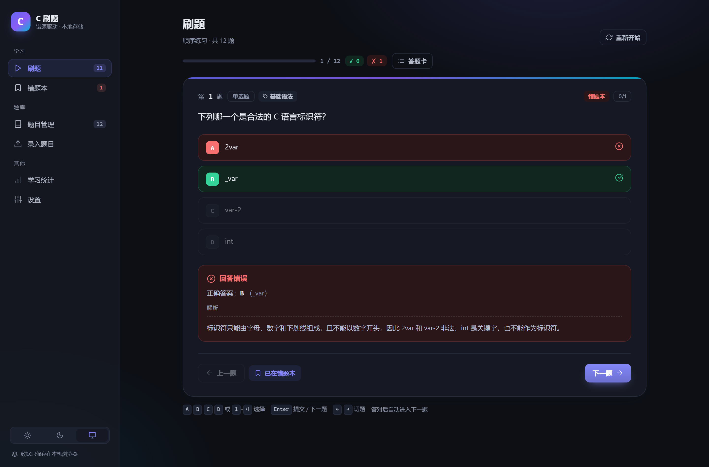
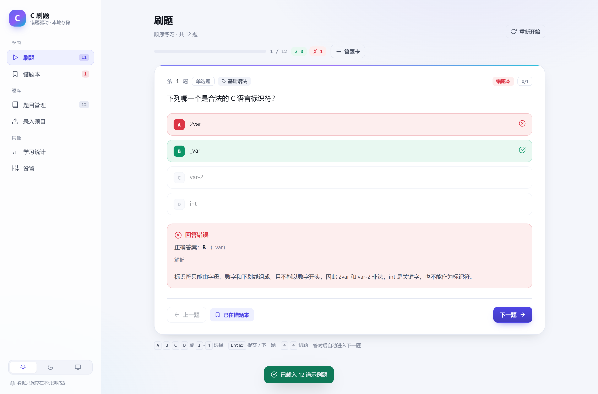
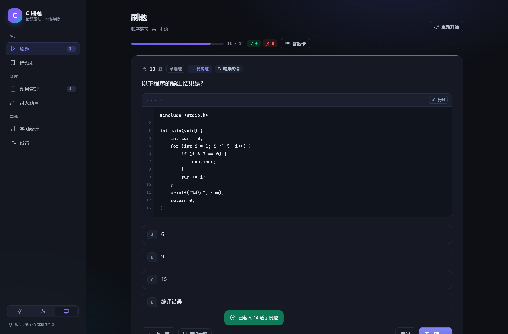
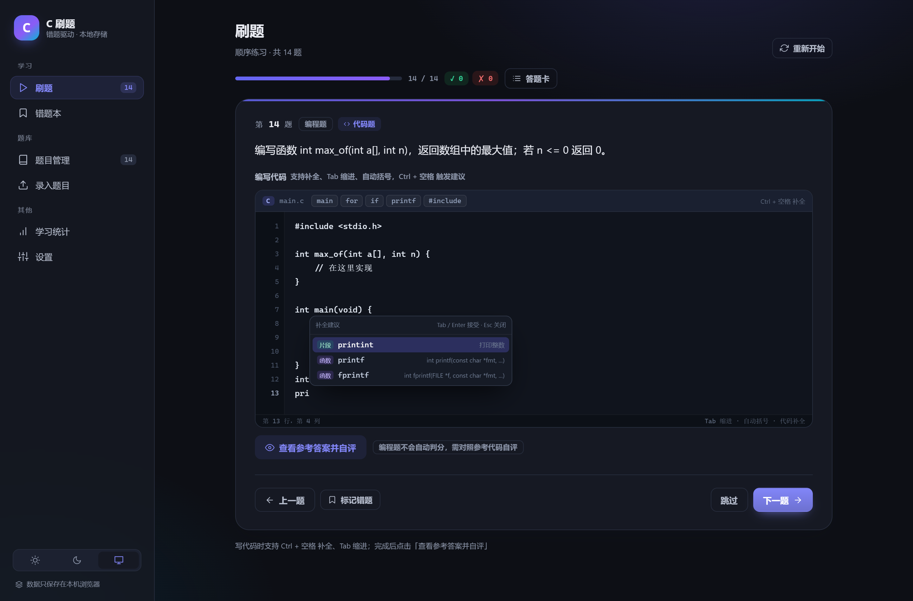
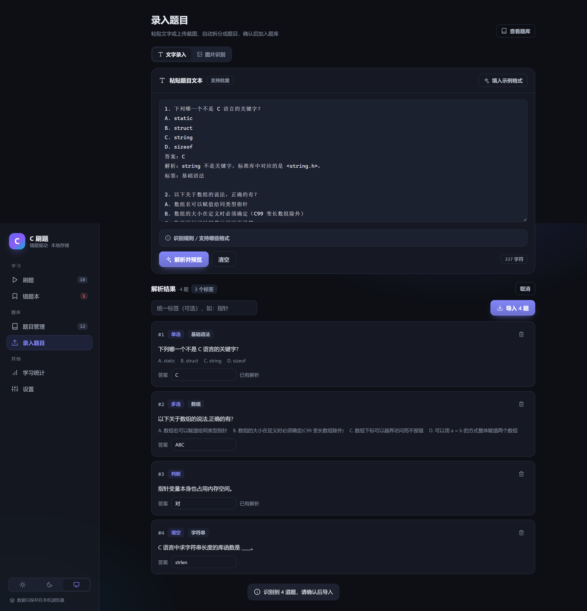

# C 语言刷题助手

一个完全本地运行的 C 语言刷题工具：把题目文字或截图丢进去，自动拆成一道道题，然后连续刷题、自动收集错题。支持程序阅读题、程序填空题和编程题，内置一个类似 VS Code 的 C 代码编辑器（语法高亮 + 代码补全）。

不需要注册账号，不需要联网（图片识别也内置在本地），所有数据只保存在你自己的浏览器里。

## 预览

| 刷题（深色） | 刷题（浅色） |
| --- | --- |
|  |  |

| 程序阅读题 | 编程题 · 代码补全 |
| --- | --- |
|  |  |



---

## 功能

### 录题

- **文字录入**：粘贴带答案的题目，自动识别题号、选项、答案、解析、标签，支持单选 / 多选 / 判断 / 填空
- **图片识别**：截图、照片拖进来或直接 `Ctrl + V` 粘贴，本地 OCR 识别成文字；识别结果可以修改后再解析
- **手动新增**：在「题目管理」里逐题填写，支持 Markdown 风格代码块
- **题目模板**：新建题目时可一键套用「程序阅读题（单选 / 填空）」「程序填空题」「编程题」等模板，直接改内容即可
- **导入预览**：解析后先预览，可逐题补答案、删除误识别的内容，确认后再入库；重复题目自动跳过

### 代码题

- 新增 **程序阅读题**：题目代码单独存放，刷题时以带行号、语法高亮的代码块展示，可一键复制
- 新增 **编程题**：练习时在代码编辑器里写代码，点「查看参考答案并自评」后对照参考代码自评对错
- **C 代码编辑器**（编写题目、练习作答都能用）：
  - C 语法高亮、行号、当前行提示
  - 输入 `pr` 自动弹出补全，支持 C 关键字、标准库函数（带签名）、常用代码片段
  - `Ctrl + 空格` 或 `Alt + /` 手动唤出补全，`↑` `↓` 选择、`Tab` / `Enter` 接受、`Esc` 关闭
  - 自动括号配对、`Tab` 缩进 / `Shift + Tab` 反缩进、回车自动缩进、粘贴保留
  - 练习时写的代码会自动存草稿，刷新页面也不丢
- 题库支持 **只看代码题** 筛选，也能按「编程题」题型筛选

### 刷题

- 五种模式：顺序练习、随机练习、未做题目、错题重练、按标签练习
- 答题进度自动保存，随时关掉页面，下次打开接着刷
- 单选题 / 判断题点击即判，多选题和填空题提交后判题；编程题自评
- 答错立刻显示正确答案和解析；答对可自动进入下一题（可在设置中关闭）
- 答题卡一眼看到哪些题答对、答错、未做，点击可直接跳题
- 键盘快捷键：`A`–`D` / `1`–`4` 选项，`Enter` 提交 / 下一题，`←` `→` 切题

### 错题

- 答错的题会自动进入错题本，并记录错误次数、上次作答、最近错误时间
- 错题答对后自动移出；也可以手动「标记错题」「已掌握」
- 支持错题搜索、按最近答错 / 错得最多排序、一键重练、单题重做

### 统计

- 题库总数、已练习、总正确率、错题待复习
- 最近 7 天练习量柱状图
- 标签掌握情况（按正确率排序，找出薄弱知识点）
- 最需要复习的题目排行

### 其他

- 浅色 / 深色 / 跟随系统三种主题
- 数据备份导出为 JSON，换电脑可导入恢复
- 内置 14 道 C 语言示例题（含程序阅读、编程题），可一键载入体验

---

## 快速开始

### 方式一：双击启动（推荐）

双击 **`启动刷题.bat`**，浏览器会自动打开 `http://127.0.0.1:5180`。

启动窗口不要关闭，关掉窗口就是停止服务。

> 为什么需要一个本地服务？因为浏览器在 `file://` 协议下不允许使用 IndexedDB 和 Web Worker，而本程序需要它们来保存数据和做图片识别。

### 方式二：开发模式

```bash
pnpm install
pnpm dev
```

然后打开终端提示的地址（默认 `http://127.0.0.1:5175`）。

### 方式三：构建后运行

```bash
pnpm install
pnpm build
pnpm start
```

`pnpm start` 会在 `http://127.0.0.1:5180` 启动静态服务；端口被占用时会自动顺延。

### 从 GitHub 克隆

```bash
git clone https://github.com/<你的用户名>/c-quiz.git
cd c-quiz
pnpm install
pnpm dev          # 开发调试
# 或者：pnpm build && pnpm start
```

> 仓库里**不包含 `dist/` 构建产物**（约 24 MB，且每次构建都会变），克隆后第一次双击 `启动刷题.bat` 会自动安装依赖并构建；也可以手动执行 `pnpm build`。

---

## 录题格式

粘贴下面这种格式即可，题号、选项、答案、解析、标签都是可选的（但**答案必须要有**，没有答案的题可以在预览里补）：

```text
1. 下列哪一个不是 C 语言的关键字？
A. static
B. struct
C. string
D. sizeof
答案：C
解析：string 不是关键字，标准库中对应的是 <string.h>。
标签：基础语法

2. 以下关于数组的说法，正确的有？
A. 数组名可以赋值给同类型指针
B. 数组的大小在定义时必须确定
C. 数组下标可以越界访问而不报错
D. 可以用 a = b 的方式整体赋值两个数组
答案：A、B、C
```

支持的写法：

| 内容 | 支持的格式 |
| --- | --- |
| 题号 | `1.` `1、` `(1)` `第1题`，没有题号时按空行分段 |
| 选项 | `A.` `A、` `A)`，一行里写了多个选项也能自动拆开 |
| 答案 | `答案：A` `正确答案：A、C` `Answer: A` |
| 判断题 | 答案写 `对` / `错`（也认 `正确` `错误` `√` `×` `T` `F`） |
| 填空题 | 没有选项、答案不是对/错时自动按填空题处理；多个可接受答案用 `|` 分隔，如 `malloc|calloc` |
| 解析 | `解析：…` / `分析：…` / `说明：…` |
| 标签 | `标签：指针, 数组` 或 `知识点：…` |

题干可以写多行，也可以直接写 Markdown 代码块：

````text
3. 以下程序的输出结果是？
```c
#include <stdio.h>
int main(void) {
    int a[5] = {1, 2, 3};
    printf("%d\n", a[3]);
    return 0;
}
```
A. 0
B. 1
C. 3
D. 随机值
答案：A
````

---

## 代码题怎么录

「题目管理 → 新增题目」里有 6 个模板，点一下就能得到一份可以改的骨架：

| 模板 | 用途 |
| --- | --- |
| 程序阅读题（单选） | 给一段代码 + 4 个选项，问输出结果 |
| 程序阅读题（填空） | 给一段代码，直接填运行结果 |
| 程序填空题 | 代码里留一个 `____`，让练习者填表达式 |
| 编程题 | 题目描述 + 起始代码 + 参考答案，练习时自评 |
| 基础选择题 / 判断题 | 普通题型骨架 |

也可以手动组合：

- 任何题型都可以点「添加题目代码」，这段代码会显示在题干下方（适合程序阅读题）
- 选「编程题」后会出现两个代码编辑器：**起始代码**（练习时的初始内容）和 **参考答案**（自评时对照）
- 代码编辑器支持补全、语法高亮、括号配对和自动缩进，直接写就行
- 其他途径也行：文字导入里用 ` ```c ` 代码块写题干，或截图识别后改一改

> 编程题没有编译器，所以采用「对照参考答案自评」：先写代码 → 查看参考答案 → 选「我写对了 / 没写对」，结果会正常计入正确率和错题本。

---

## 图片识别说明

- 使用 [tesseract.js](https://tesseract.js.org/) 在浏览器里做 OCR，识别引擎和中英文语言包（约 4.6 MB）已经内置在 `public/` 中，**断网也能用**
- 第一次识别需要加载引擎和语言包，大约几秒；之后会快很多
- 自动做了放大、灰度、深色截图反色等预处理，提高截图识别率
- **代码符号容易被识别错**（比如 `*` 和 `+`、`0` 和 `O`），识别完请先检查再导入
- 一张图里可以有多道题，识别结果会追加到文本框，一起解析

---

## 数据与备份

- 所有题目、答题记录、统计都存在浏览器的 **IndexedDB** 里（站点数据），不会上传到任何服务器
- 清理浏览器缓存 / 站点数据会导致数据丢失，建议定期在「设置 → 导出备份」保存 JSON
- 换电脑时：导出 JSON → 新机器上「导入备份」即可
- 注意：如果通过不同端口访问（如 5180 / 5181），浏览器会当作不同站点，数据不互通

---

## 快捷键

| 按键 | 作用 |
| --- | --- |
| `A` `B` `C` `D` / `1` `2` `3` `4` | 选择选项 |
| `1` / `2` | 判断题选「正确」/「错误」 |
| `Enter` | 提交答案 / 下一题 |
| `←` `→` | 上一题 / 下一题 |
| `Ctrl + 空格` / `Alt + /` | 代码编辑器中唤出补全 |
| `↑` `↓` | 补全列表上下选择 |
| `Tab` / `Enter` | 接受补全（补全未打开时 `Tab` 为缩进） |
| `Shift + Tab` | 反缩进 |
| `Ctrl + V` | 在图片录入页粘贴截图 |
| `Esc` | 关闭补全 / 弹窗 |

---

## 项目结构

```
c-quiz/
├─ index.html
├─ src/
│  ├─ App.tsx           # 布局与路由
│  ├─ store.tsx         # 全局状态、持久化、答题判分
│  ├─ db.ts             # IndexedDB 封装
│  ├─ types.ts          # 数据模型
│  ├─ lib/
│  │  ├─ parse.ts       # 题目文本解析（核心）
│  │  ├─ ocr.ts         # tesseract.js 封装、图像预处理
│  │  ├─ cLanguage.ts   # C 关键字 / 标准库函数 / 片段补全数据
│  │  ├─ highlight.tsx  # C 语法着色
│  │  ├─ templates.ts   # 代码题等题目模板
│  │  └─ utils.ts       # 判分、格式化等
│  ├─ components/
│  │  ├─ CodeEditor.tsx # 带补全的 C 代码编辑器
│  │  ├─ CodeBlock.tsx  # 只读代码块（行号 / 复制）
│  │  └─ ...            # 图标、弹窗、题目编辑器、富文本
│  ├─ views/            # 刷题 / 题库 / 错题 / 录入 / 统计 / 设置
│  └─ styles.css        # 全部样式（含深色主题）
├─ public/
│  ├─ tesseract/        # OCR worker
│  ├─ tesseract-core/   # WASM 引擎
│  └─ tessdata/         # 中英文语言包
├─ server.mjs           # 本地静态服务器
└─ 启动刷题.bat          # 一键启动
```

## 技术栈

- React 19 + TypeScript + Vite
- tesseract.js 7（本地 OCR）
- IndexedDB（数据持久化，无后端）
- 自研 C 代码编辑器（语法着色 + 补全），不依赖 Monaco / CodeMirror
- 纯手写 CSS，无 UI 框架依赖

---

## 常见问题

**Q：双击 bat 后黑窗口一闪而过？**
A：说明 Node.js 未安装或版本过低，安装 [Node.js](https://nodejs.org/) 20+ 后重试；窗口里会有具体提示。

**Q：能不能直接双击 `dist/index.html`？**
A：不行，`file://` 下无法使用 IndexedDB / Worker，请用启动脚本访问 `http://127.0.0.1:5180`。

**Q：端口被占用？**
A：`server.mjs` 会自动尝试 5181、5182…，以窗口里打印的地址为准。

**Q：图片识别很慢？**
A：首次要加载约 4.6 MB 的语言包和 WASM 引擎；之后会从缓存加载。截图越大识别越慢，建议只截题目区域。

**Q：编程题怎么判分？能运行代码吗？**
A：不会真的编译运行（纯前端、无后端沙箱）。练习时你写代码，点「查看参考答案并自评」后自己选「写对了 / 没写对」，结果会照常计入正确率和错题本。

**Q：按 Ctrl + 空格没弹出补全？**
A：中文输入法通常占用了 `Ctrl + 空格` 切换输入法，可以改用 `Alt + /` 唤出补全；直接输入两个字母也会自动弹出。

**Q：代码编辑器里的中文注释输入正常吗？**
A：使用原生 textarea 实现，中文输入法候选框正常；输入过程中会暂时隐藏高亮，输入完成后自动恢复。

**Q：怎么删除所有数据？**
A：「设置 → 清空全部数据」，或清除该站点的浏览器数据。

---

## 许可

本项目代码以 [MIT](LICENSE) 协议开源。

`public/tesseract/`、`public/tesseract-core/`、`public/tessdata/` 下的 OCR 资源来自 tesseract.js / Tesseract tessdata_best，遵循 Apache-2.0 协议，详见 [THIRD_PARTY_NOTICES.md](THIRD_PARTY_NOTICES.md)。

